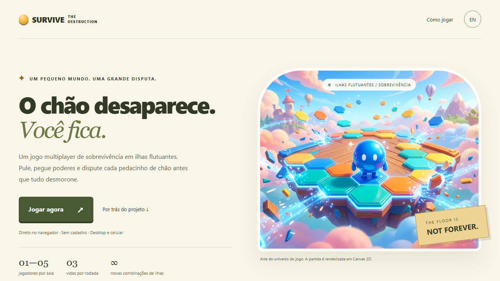

# 🎮 SURVIVE THE DESTRUCTION

Jogo multiplayer em tempo real onde a arena de ilhas flutuantes é destruída aos poucos. Sobreviva ao maior tempo possível, pule entre as ilhas, use power-ups e empurre os oponentes enquanto o chão desaparece debaixo dos seus pés.

> 📘 Guia mais amigável e completo em [guia-do-projeto.md](./guia-do-projeto.md).

### Documentação e demonstração

- [Protocolo WebSocket completo](docs/websocket.md): mensagens, campos, salas, limites, desconexão e reconexão.
- [Arquitetura e avaliação técnica](docs/arquitetura.md): responsabilidades, concorrência, decisões e limites conhecidos.
- [Demonstração reproduzível](docs/demonstracao.md): dois jogadores reais, PostgreSQL descartável e testes no navegador.
- [Capturas de execução](docs/evidence/README.md): home desktop/mobile, personalização e gameplay.



## ✨ Funcionalidades

- **Home explicativa** em PT/EN, independente do backend: conceito, mecânicas, controles e apresentação técnica; personalização antes da conexão.
- **Multiplayer em tempo real** via WebSocket, em salas independentes com até 5 jogadores e alocação automática.
- **Arena procedural**: ilhas flutuantes geradas aleatoriamente a cada rodada.
- **Destruição contínua**: a cada 3s um bloco fica vermelho (1s) e é destruído — o mapa encolhe de verdade.
- **Quadrado perdido**: de vez em quando uma plataforma extra (halo dourado) aparece em posição aleatória e fica até ser destruída.
- **Power-ups**:
  - 🍄 vermelho = **Tanque** (dobra o raio da bola);
  - 🍄 roxo = **Velocista** (movimento mais rápido);
  - 💎 azul = **Planar** (planar no ar com hélice).
- **Cor da bolinha personalizada**: o jogador escolhe a cor na tela inicial (fica salva no navegador) e todos veem a cor de todos.
- **Física com polimento**: pulo duplo, coyote time, jump buffer, dash com knockback em oponentes, respawn anti-trava.
- **Vidas e rodadas**: 3 vidas por rodada; placar por tempo sobrevivido; Top 10 no leaderboard.
- **Mobile completo**: trava em paisagem (inclusive na tela de carregamento), tela cheia, controles de toque, suporte a safe-area (notch) e telas de carregamento sorteadas.
- **Tela de carregamento em tela cheia**: imagem de fundo integral + spinner + "Procurando partida...", com aviso de rotação em retrato no celular.
- **Health check inteligente**: após personalizar, aguarda `/api/health` e `/api/config`, com tentativas a cada ~4s por até 5 min. Sair cancela os HTTPs; indisponibilidade não bloqueia a home.
- **Conexões organizadas**: reconexão com backoff/jitter e aviso visual; encerramento coordenado de HTTP, Hub, sockets e gravações pendentes.

## 🧱 Stack

| Camada | Tecnologia |
| ------ | ------ |
| Frontend | React 19 + Vite 7 + MUI 7 + Canvas API |
| Backend | Go 1.25 + gorilla/websocket |
| Banco de dados | PostgreSQL (Neon) via lib/pq |
| Deploy | Vercel (frontend) + Render (backend) |

## 📁 Estrutura do Projeto

```text
backend/
  main.go              # Bootstrap, env, servidor HTTP e shutdown gracioso
  controller/
    hub.go             # Loop serializado (16 ms), clientes, salas e shutdown
    client.go          # Pumps de leitura/escrita do WebSocket
    room.go            # Partida isolada: rodada, comandos e broadcast
  models/
    movement.go        # GameState, física, arena procedural, destruição, quadrado perdido
    powerup.go         # Power-ups e buffs
  routes/
    routes.go          # Rotas /ws, /api/scores, /api/config e /api/health + CORS
  service/
    poster.go          # Persistência do placar no PostgreSQL
frontend/
  index.html
  src/
    App.jsx            # Navegação home/jogo e carregamento dinâmico
    Game.jsx           # Coordenação da cena, HUD, efeitos e carregamento
    components/Home.jsx # Apresentação e personalização, sem I/O de backend
    network/           # Sessão WebSocket e prontidão HTTP cancelável
    hooks/             # Controles de teclado com cleanup
    renderer/          # Sprites, cores e primitivas Canvas sem React/rede
    sfx.js             # Efeitos sonoros (Web Audio)
    index.css          # Reset e estilos globais
  assets/              # Imagens (telas de carregamento, logo, etc.)
```

## 🚀 Como Rodar Localmente

### Pré-requisitos

- Node.js 20.19+ ou 22.12+ (ou versão LTS mais nova) e npm
- Go 1.25+
- Um PostgreSQL acessível (local, Docker ou Neon)

### 1. Backend

```bash
# na raiz do repositório, crie o .env a partir do exemplo
cp .env.example .env
# preencha DATABASE_URL com a string de conexão do seu PostgreSQL
```

```bash
cd backend
go mod download
go run .
```

O servidor sobe em `http://localhost:8080`.

> O backend **não inicia** sem `DATABASE_URL` válida (ele falha de propósito). Use a mesma base PostgreSQL do exemplo ou crie uma local.

### 2. Frontend

```bash
cd frontend
npm install
# opcional: configure as URLs do backend local
cp .env.example .env
# .env => VITE_WS_URL=ws://localhost:8080/ws e VITE_API_URL=http://localhost:8080
npm run dev
```

Abra `http://localhost:5173`.

> Sem `.env`, o frontend usa os endpoints de produção (Render) como fallback.

### Comandos úteis

```bash
# Backend
cd backend
go test ./...          # testes
go build ./...         # build
go vet ./...           # análise estática

# Frontend
cd frontend
npm run lint           # eslint
npm run build          # build de produção (dist/)
npm run preview        # serve o build localmente
```

## 🎮 Controles

| Ação | Teclado (desktop) | Toque (mobile) |
| ---- | ------ | ------ |
| Mover | A / D ou ← / → | ◀ ▶ (inferior esquerdo) |
| Pular (pulo duplo) | W ou Espaço | ⬆ (inferior direito) |
| Dash (empurra oponentes) | Shift | ⚡ (inferior direito) |
| Iniciar partida | Enter | Botão INICIAR JOGO |

## 🔌 API

### `GET /api/health`

Health check de prontidão do servidor. É o endpoint que o front usa para **sair da tela de carregamento** (a tela "Procurando partida..." só some quando ele responde `200`).

```json
{ "status": "ok" }
```

### `GET /api/config`

Retorna as constantes compartilhadas do jogo (arena, física, power-ups) para evitar drift entre backend e frontend.

```json
{
  "arena_width": 800,
  "arena_height": 1000,
  "tile_size": 100,
  "break_interval": 3,
  "max_lives": 3,
  "dash_cooldown": 1.5
}
```

### `GET /api/scores`

Retorna o Top 10 de sobreviventes.

```json
[
  { "name": "Jogador1234", "score_seconds": 42 }
]
```

### `WS /ws`

Conexão WebSocket do jogo. Protocolo de mensagens:

**Cliente → Servidor**

```json
{ "type": "join", "name": "Jogador1234", "color": "#f2b544" }
{ "type": "input", "left": false, "right": true, "jump": false, "dash": false }
{ "type": "restart" }
```

**Servidor → Cliente**

```json
{ "type": "init", "player_id": "player_1", "room_id": "sala_1" }
```

Em seguida, o servidor envia snapshots completos da sala a cada tick de 16 ms (~60 Hz), **sem `type`**: `players`, `arena_tiles`, `power_ups`, `status`, `round`, `round_over`, `countdown`, `arena_width`, `arena_height`, `drop_countdown`, `room_id`, `room_players`, `room_capacity`.

`input` contém o estado completo das quatro teclas e é repetido a cada 100 ms pelo cliente. Reconexão cria uma nova participação, não recupera score/vidas/sala anteriores. Veja o [contrato completo](docs/websocket.md).

## ⚙️ Variáveis de Ambiente

### Raiz (backend)

| Variável | Obrigatória | Descrição |
| ---- | ---- | ---- |
| `DATABASE_URL` | Sim | String de conexão do PostgreSQL |
| `HTTP_ADDR` | Não | Endereço do servidor (padrão `:8080`) |
| `ALLOWED_ORIGINS` | Não | Origens permitidas no WebSocket/CORS (padrão `http://localhost:5173`) |

### Frontend

| Variável | Obrigatória | Descrição |
| ---- | ---- | ---- |
| `VITE_WS_URL` | Não | URL do WebSocket (fallback: produção Render) |
| `VITE_API_URL` | Não | URL base da API (fallback: produção Render) |

> Nunca commite `.env` reais. O `.env.example` é o modelo seguro.

## ☁️ Deploy

- **Backend → Render**: serviço web Go, `rootDir: backend`, build `go build -o server .`, start `./server`. Variáveis: `DATABASE_URL`, `ALLOWED_ORIGINS` (origem do Vercel), `HTTP_ADDR`.
- **Frontend → Vercel**: aplicação estática Vite (pasta `frontend/`). As URLs do backend são injetadas via `VITE_WS_URL` e `VITE_API_URL`.

## 🧠 Mecânicas e Decisões Técnicas

- **Física no servidor**: todo movimento, colisão e destruição rodam no backend (tick a ~60 FPS); o frontend apenas renderiza a posição autoritativa. Isso mantém todos os jogadores sincronizados.
- **Prontidão via `/api/health`**: só começa após entrar pela home/personalização. Health/config têm timeout e cancelamento ao sair; erro após aproximadamente 5 minutos de tentativas (cold start do Render).
- **Anti-trava**: jogador parado no chão por 4s é reposicionado sem perder placar.
- **Destruição da arena**: um tile ativo aleatório é escolhido a cada 3s; ele fica vermelho por 1s e vira buraco. Quando não sobra bloco ativo, a rodada termina.
- **Quadrado perdido**: a cada 8–14s um tile `kind: "lost"` é criado em célula vazia aleatória e participa da destruição normal.
- **Cor da bolinha**: hex `#rrggbb` sanitizado no servidor (`SanitizeColor`); o frontend deriva tons (gradiente, brilho, trilha) da cor escolhida. Cor vazia/inválida usa o âmbar padrão.
- **Mobile em paisagem**: trava `screen.orientation.lock('landscape')` (Android) já na tela de carregamento, com aviso de rotação se o celular estiver em retrato; canvas com `contain` (arena inteira visível) e controles reposicionados com `env(safe-area-inset-*)`.

## 🧪 Testes

```bash
cd backend
go test ./...
go test -race ./...  # exige CGO/compilador C; alternativa Docker no roteiro
go vet ./...

# Em frontend/
npm test            # transporte, readiness e sprites com node:test
npm run lint
npm run build
npx playwright install chromium
npm run test:e2e    # backend de teste na porta 18080; veja o roteiro
```

Cobertura funcional: física, power-ups, salas, rodadas, sanitização, integração WebSocket real, encerramento de conexões, prontidão, reconexão e timers. O E2E demonstra dois jogadores com banco real e home mobile; configure o ambiente conforme [docs/demonstracao.md](docs/demonstracao.md).
